<h1 align="left">Bonjour 👋, je suis Manuel Pussenot</h1>

**Étudiant en Bachelor Informatique à [Coda](https://coda.school) Dijon**, orienté **systèmes et réseaux**.
Je cherche une **alternance pour septembre 2027**, au rythme de 3 semaines en entreprise et 1 semaine en cours.

Ancien technicien de chantier sur site nucléaire sécurisé (CEA Valduc), j'ai gardé de cette expérience la rigueur et le respect des procédures. Aujourd'hui, je les mets au service de l'infrastructure informatique.

---

### 🛠️ Technologies

### 📂 Projets

| Projet | Description | Technos |
|---|---|---|
| [**Projet SVG**](https://github.com/ManuNecro/Projet_SVG) | Éditeur et moteur de rendu vectoriel en ligne de commande : formes 2D, transformations et export SVG | C, Makefile |
| **Serveur communautaire** | Création et administration d'un serveur de jeu communautaire (fangame) | Linux / BSD, réseau |
| [**HTML / CSS**](https://github.com/ManuNecro?tab=repositories) | Exercices et projets de groupe en intégration web *mobile first* | HTML, CSS |

### 📊 Statistiques

  
  

### 📫 Me contacter

